# OPNsense VirtualBox Lab — Firewall Configuration and Rule Validation

> **Project:** [HP t730 — Frigate & IoT Security Lab](https://github.com/Dennyboy21/t730-frigate-iot-lab)  
> **Exercise:** Laptop practice — OPNsense installation, isolated networking, and firewall testing  
> **Lab date:** October 17, 2026  
> **Status:** Completed in VirtualBox; HP t730 deployment remains planned.

## 1. Objective

Build an isolated, reproducible firewall training environment using **OPNsense 26.7** and a **Kali Linux** test VM in Oracle VirtualBox. Validate network configuration, DHCP, routing, DNS, internet access, firewall rule ordering, traffic logging, and rollback **without putting the production home network behind the experimental firewall**.

This is a **practice implementation**, not a claim that Proxmox, Frigate, or OPNsense has been deployed on the HP t730.

## 2. Lab topology

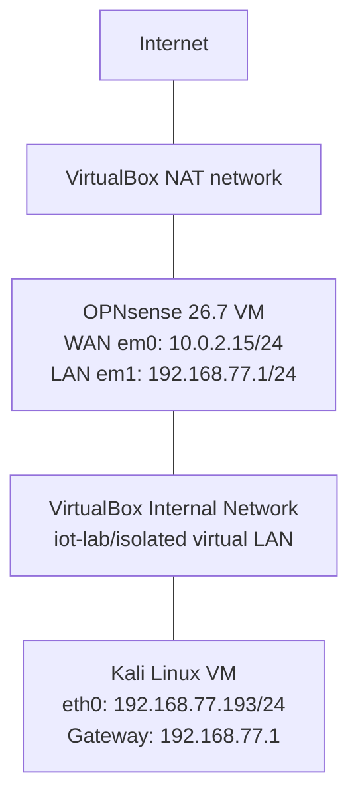

**Isolation:** OPNsense's WAN uses VirtualBox NAT. Its LAN and Kali's adapter use the *same named VirtualBox Internal Network*. Internal Network mode does not attach the lab directly to the Windows host or the physical home LAN; internet access is provided by the firewall and its upstream virtual NAT connection.

### VirtualBox adapter evidence

| Component | Adapter/interface | Mode / assignment |
| --- | --- | --- |
| OPNsense | Adapter 1 / `em0` | VirtualBox NAT; WAN via DHCP |
| OPNsense | Adapter 2 / `em1` | Internal Network; LAN |
| Kali Linux | Adapter 1 / `eth0` | Same Internal Network as OPNsense LAN |

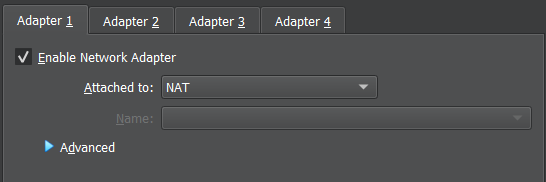

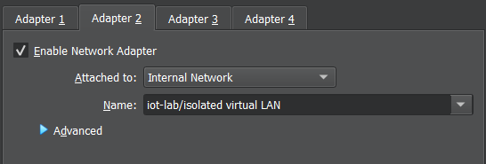

## 3. Installation and baseline configuration

OPNsense **26.7 (amd64)** was installed to a **20 GB VirtualBox virtual disk** using the **UFS** install option. The installer ISO was removed before booting the installed system. A root password was configured during installation (not disclosed or stored in this repository).

After initial boot, the interfaces were reassigned to match their VirtualBox connections:

| Setting | Result |
| --- | --- |
| WAN / `em0` | IPv4 via DHCP (`10.0.2.15/24` during testing) |
| LAN / `em1` | Static IPv4 `192.168.77.1/24` |
| LAN DHCP pool | `192.168.77.100`–`192.168.77.199` |
| LAN upstream gateway | None |
| LAN IPv6 | Left unconfigured for these IPv4 exercises |
| Web management | HTTPS, available to a client on the isolated LAN |

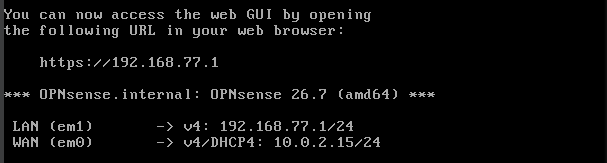

The Kali test VM obtained **`192.168.77.193/24` by DHCP** and a default route via **`192.168.77.1`**. The address is a dynamically assigned *lab* address; it may change after a restart or new DHCP lease.

```console
$ ip -4 addr
# eth0: 192.168.77.193/24 (dynamic)
$ ip route
default via 192.168.77.1 dev eth0 proto dhcp
192.168.77.0/24 dev eth0 proto kernel scope link src 192.168.77.193
```

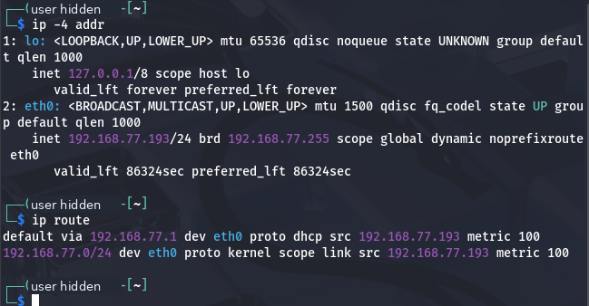

## 4. Connectivity baseline

Before applying a custom blocking rule, the firewall's WAN successfully pinged `1.1.1.1` and resolved/pinged `opnsense.org`, verifying its own upstream reachability and DNS resolution.

Then, from Kali:

| Test | Command | Observed outcome |
| --- | --- | --- |
| LAN gateway reachability | `ping -c 3 192.168.77.1` | 3/3 replies; 0% packet loss |
| External name resolution and reachability | `ping -c 3 opnsense.org` | Resolved hostname; 3/3 replies; 0% packet loss |
| HTTPS web management | Open `https://192.168.77.1` in Kali | OPNsense login and authenticated dashboard accessed |

The successful Kali-to-internet test supports the conclusion that client traffic could traverse OPNsense and the upstream VirtualBox NAT connection at baseline; it does not establish performance under production load.

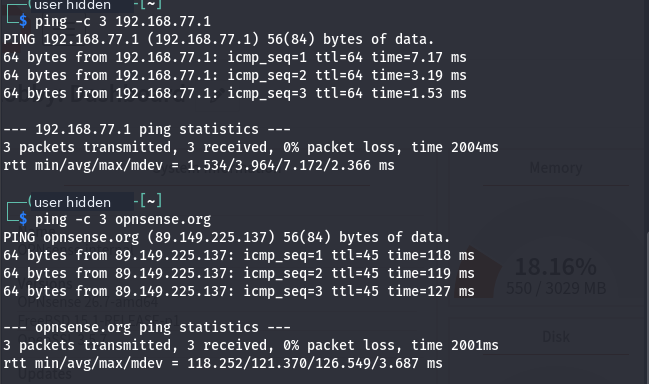

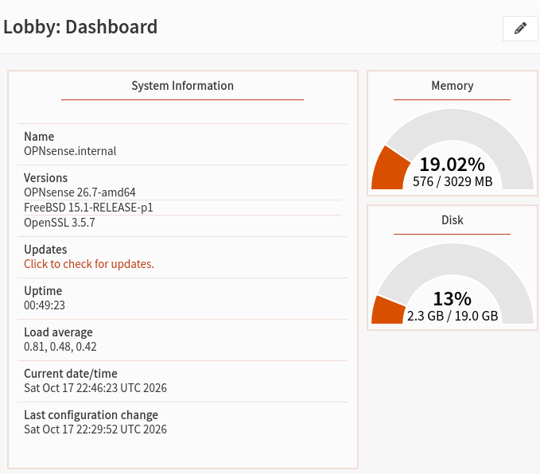

## 5. Firewall rule experiment: selective ICMP block

**Hypothesis:** A specific, enabled inbound LAN quick rule set to **Block** for ICMP Echo Requests from Kali to `1.1.1.1` will deny those ping requests while ordinary HTTPS traffic remains functional.

### Rule parameters

| Field | Value |
| --- | --- |
| Description | `LAB - Block Kali ICMP to 1.1.1.1` |
| Enabled during test | Yes |
| Interface | LAN |
| Direction | In |
| Quick | Enabled |
| Action | Block |
| IP version | IPv4 |
| Protocol/type | ICMP / Echo Request |
| Source | `192.168.77.193/32` |
| Destination | `1.1.1.1/32` |
| Ports | Any (not applicable to ICMP) |
| Logging | Enabled |
| Rule position | Above the default IPv4 LAN pass rule |

The **`/32` host masks** limit this rule to one lab source address and one destination. Since the source address was assigned dynamically, an address change would require updating the rule or using a stable DHCP reservation/alias.

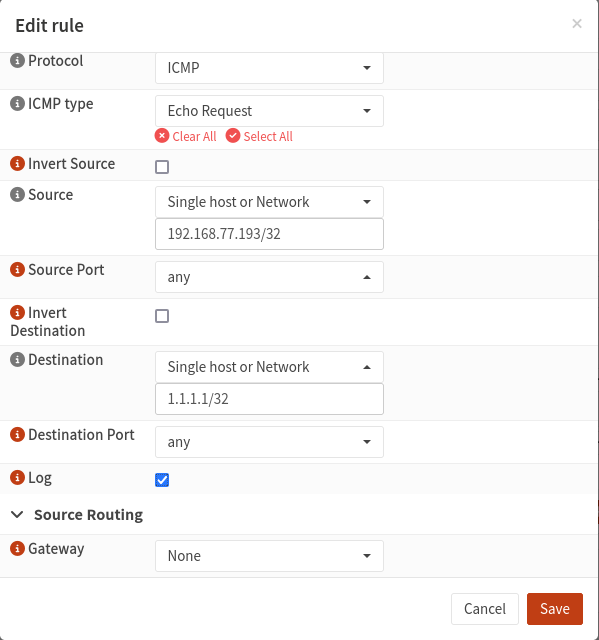

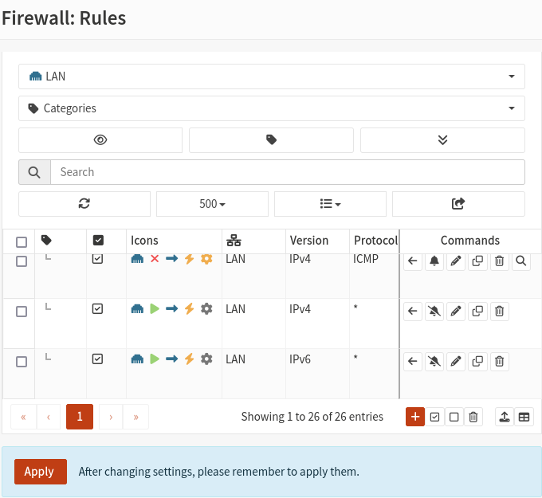

### Validation procedure and observed results

1. Saved the new blocking rule and moved it above the general LAN IPv4 pass rule.
2. Applied the firewall configuration.
3. From Kali, ran `ping -c 3 1.1.1.1`.
4. From Kali, ran `curl -I --max-time 10 https://example.com`.
5. Opened **Firewall → Log Files → Live View** in OPNsense and inspected entries for the test.

| Test | Expected | Observed |
| --- | --- | --- |
| Ping `1.1.1.1` while block active | No replies | **3 sent; 0 received; 100% loss** |
| HTTPS HEAD request to `example.com` | Remains allowed | **HTTP/2 200** |
| Firewall log entries | Blocked ICMP from Kali to `1.1.1.1` | **Block** entries on LAN / inbound / ICMP, labeled with the lab rule |

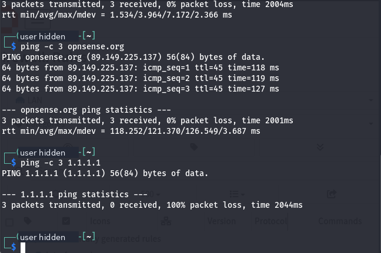

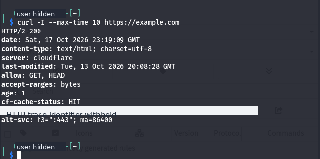

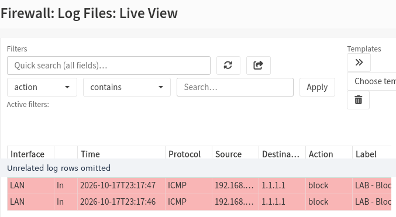

**Interpretation:** The test demonstrates successful enforcement of a **selective** firewall rule with associated log evidence, not a complete interruption of Kali's network connectivity. Ordering the specific quick block before a broader pass rule was essential to the test design.

## 6. Rollback and recovery verification

After reviewing the logs, the test rule was **disabled (not deleted)** and the firewall changes were applied. Kali was tested again:

```console
$ ping -c 3 1.1.1.1
# 3 packets transmitted, 3 received, 0% packet loss
# round-trip avg: 21.734 ms
```

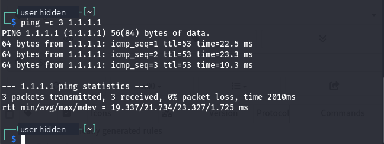

Normal connectivity returned. Keeping the rule disabled provides a convenient reference for a later lab without leaving the restriction active.

### Snapshot checkpoints

Both VMs were snapshotted after testing:

- **OPNsense-Lab:** `02 - Working LAN and Firewall Baseline`
- **Kali / Home Cybersecurity Lab:** `02 - OPNsense LAN and Firewall Testing Complete`

Snapshot names document checkpoints; snapshots do not replace an off-VM backup or a sanitized configuration export. Avoid committing VirtualBox disk images, saved-state files, OPNsense configuration XML, or secrets to Git.

## 7. Lessons learned

- **WAN vs. LAN assignment matters.** Physical/virtual adapter order must be mapped to the correct OPNsense interface.
- **DHCP lease + default route matter together.** A valid client address alone does not prove the client can reach outside the LAN.
- **Firewall-generated traffic is not the same as forwarded client traffic.** Test from the actual client to validate end-to-end behavior.
- **Rule order matters.** An earlier permissive quick rule can prevent a later block from matching.
- **Log evidence complements CLI tests.** Packet loss alone does not prove which firewall policy caused it; logs support attribution.
- **A change is not complete until rollback is verified.** Disabling and retesting the policy closed the loop.
- **Snapshots preserve a stable learning baseline.** The same starting state can be reused in later experiments.

## 8. Next steps

- Capture ICMP, DNS, and TCP sessions with Wireshark and compare observed packets with OPNsense Live View.
- Explore firewall aliases and policy exceptions, including narrowly scoped source/destination matches.
- Experiment with a **second lab subnet** and routing/segmentation without changing production home networking.
- Review IDS/IPS capabilities in an isolated, resource-aware test environment.
- Recreate the relevant virtual networking concepts on the HP t730 after hardware checks and Proxmox planning.

## 9. Public documentation and sanitization

This report represents a **home educational lab only**. It does **not** document workplace systems, site equipment, physical security controls, operational technology at an employer, or production network configuration.

All images in this folder are **curated, newly exported screenshots**, not original screenshots:

- Cropped away unrelated desktop, browser bookmarks, and VirtualBox chrome when possible.
- Removed the Kali VM's local login identifier from selected terminal screenshots.
- Excluded installation screens showing NIC MAC addresses, TLS certificate fingerprints, and any potential user secrets.
- Omitted unrelated traffic rows from the Live View image; that single image is a labeled composite excerpt of two portions of the **same original screenshot**, preserving the original block-event pixels.
- Retained **disposable lab-only RFC1918 addresses** (`192.168.77.0/24`, `10.0.2.15`) and the public test destinations because they are needed to understand and reproduce the exercise. They do not identify a real home subnet or disclose a public-facing host address.
- Exported fresh PNGs without embedded source metadata.

**Do not publish** the unsanitized originals, password manager screens, OPNsense configuration backups, private keys, API tokens, VirtualBox machine definitions, or future screenshots containing a real home WAN IP/MAC/inventory unless separately reviewed.

> **Scope note:** The network values and rule behavior above were observed in the October 17, 2026 lab session. A screenshot or initial success does not prove the same outcome after later configuration changes.
