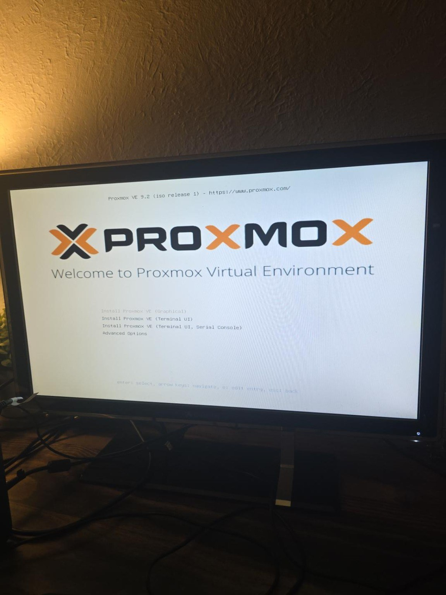
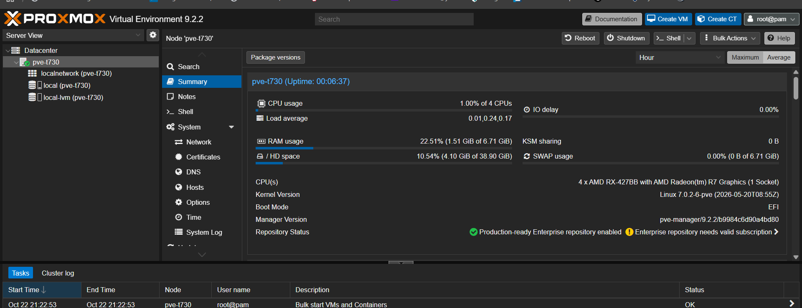

# 02 — Proxmox VE UEFI Installation and First Boot

**Period:** October 22, 2026 (Eastern Time)  
**Target:** HP t730 / 128 GB Lite-On CV8-8E128-HP

## Objective

Replace the unknown preinstalled Windows 11 environment with Proxmox VE for repeatable virtual firewall/security testing.

## Installation media and boot troubleshooting

- Previously downloaded the Proxmox VE 9.2 installer ISO and verified its checksum against the published download-page value before this session.
- Initially prepared a **32 GB USB** using Rufus in raw/DD mode after Rufus identified an ISOHybrid image.
- First HP F9 boot menu offered a **Legacy USB** option but did **not** offer **UEFI: USB**.
- Selecting the legacy USB path failed to start the installer and fell through to PXE; firmware displayed `PXE-E61: Media test failure` and `No boot disk has been detected`. The PXE message reflected the unsuccessful fallback network boot, **not evidence of a damaged SSD or Ethernet adapter**.
- Checked USB ports, HP BIOS boot-order settings, and Security → Secure Boot Configuration. Observed **Legacy Support enabled**, **Secure Boot disabled**, **Fast Boot disabled**; left Secure Boot keys intact.
- Following re-preparation of the USB installer, the boot menu **did** show `UEFI: USB`; selected it and reached the Proxmox VE 9.2 installer. An alternative writer (balenaEtcher) was recommended, but the exact program used for the successful rewrite was not confirmed in the shared screenshots.
- **Root cause not conclusively proven:** The replacement/re-prepared installer media worked; we did not isolate whether the first failure was due to image writing, port/device recognition, or firmware behavior.

## Verified installation choices

| Item | Configured |
|---|---|
| Install mode | UEFI / EFI |
| Product | Proxmox VE 9.2 (initial web GUI reported 9.2.2) |
| Destination | `/dev/sda` — Lite-On CV8-8E128, ~119.24 GiB |
| Filesystem | ext4 (default LVM-based layout) |
| Drive sizing | Installer default, `hdsize` approximately 119 GB |
| Country | United States |
| Time zone | America/Detroit |
| Keyboard | U.S. English |
| Hostname | `pve-t730` (short name displayed in installer summary; FQDN not independently verified) |
| Management interface | `nic0` / Realtek Ethernet |
| Management IPv4 | `192.168.86.10/24` |
| Gateway and DNS | `192.168.86.1` |

### Data loss acknowledgment

The installation onto `/dev/sda` deliberately replaced the existing Windows 11 installation and partitions on the 128 GB SSD. Do not repeat this operation on a disk containing wanted data.

## Result

- Proxmox completed installation, restarted, and displayed the console welcome screen and management URL.
- A Windows laptop on the household LAN reached `https://192.168.86.10:8006`.
- Authenticated as `root` using Linux PAM; confirmed the Proxmox node `pve-t730` online.
- Initial Summary displayed four AMD CPU cores, approximately 1.51/6.71 GiB RAM in use, and the root filesystem at ~4.10/38.90 GiB used. Storage is split across the root filesystem and separate LVM storage; the Summary `/ HD space` **is not the entire SSD capacity**.
- Firmware boot mode shown by Proxmox: **EFI**.

## Notes

- The management interface uses a self-signed TLS certificate initially; browser certificate warnings on the verified local address are expected until certificate trust is configured.
- Keep management and authentication restricted to the trusted LAN; do not expose TCP port 8006 to the Internet.
- Installation alone does **not** provide IoT VLAN segmentation.
