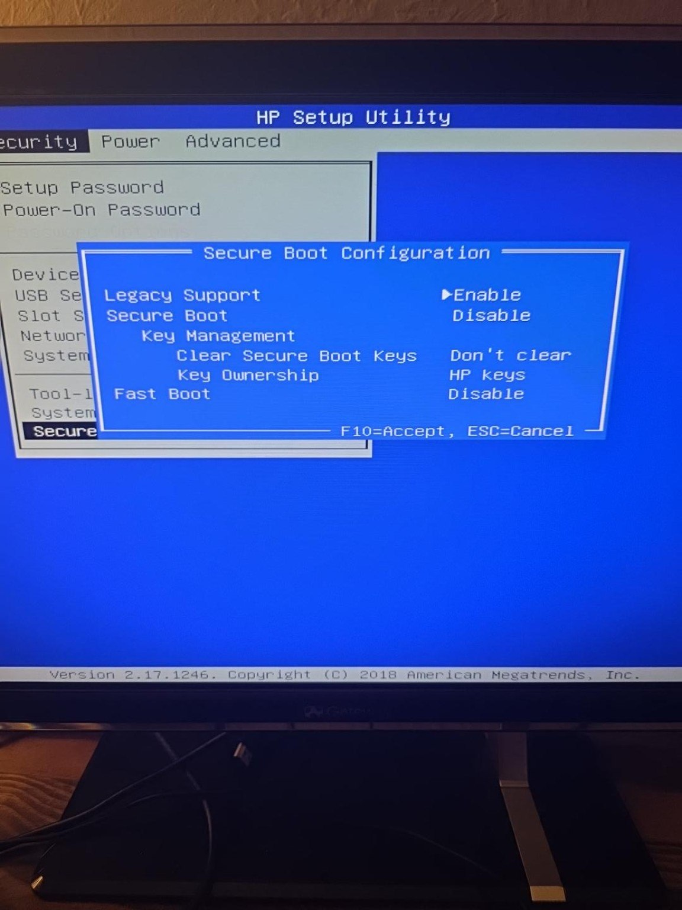
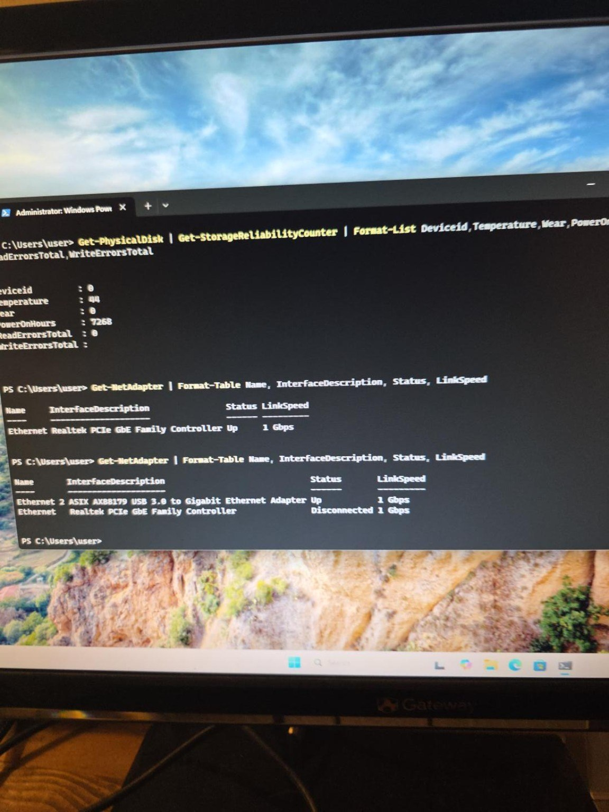
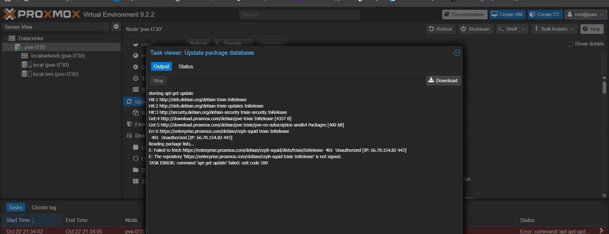
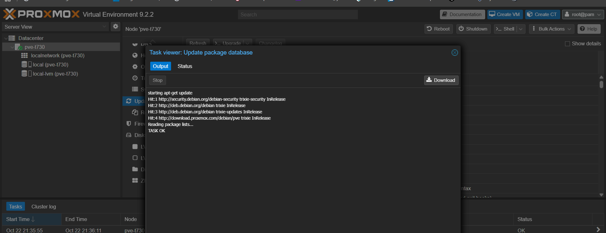
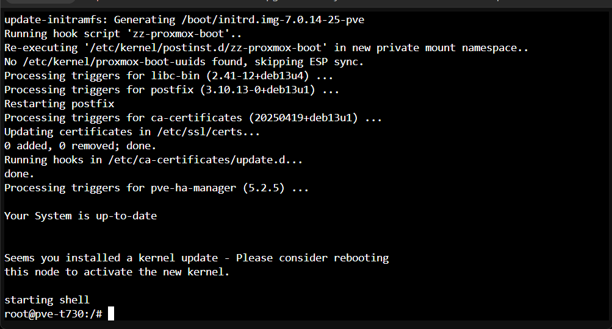
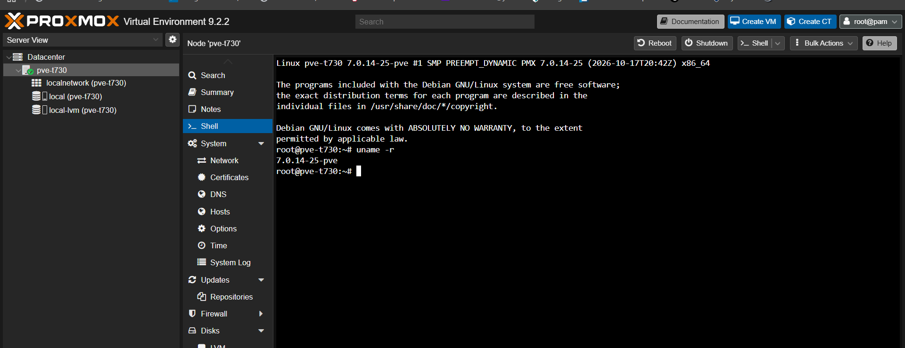
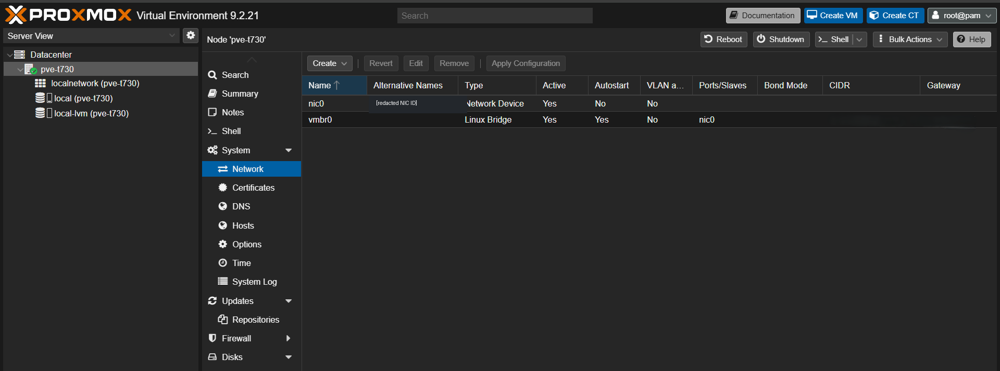

# HP t730 — Proxmox Build Documentation

**Coverage:** October 22–26, 2026. Proxmox installed and updated; OPNsense and Debian VMs deployed; host RAM upgraded from 8 GB to 16 GB.

This section records the refurbished HP t730 setup, recovery from first-boot issues, virtualization networking, snapshots, backups, thin-pool safeguards, and the verified 16 GB memory upgrade.

**The household Nest network has not been migrated or segmented.** All segmentation testing documented to date occurred in the downstream virtual lab.

## Documents

| File | Content |
|---|---|
| [01 — Hardware baseline](01-hardware-baseline.md) | Power supply issue, BIOS, RAM, SSD and Ethernet validation |
| [02 — UEFI installation](02-uefi-installation.md) | USB boot troubleshooting and successful Proxmox installation |
| [03 — Updates and recovery](03-updates-and-recovery.md) | Ceph enterprise repository error, upgrade and reboot |
| [04 — Original network plan](04-management-network.md) | Management baseline and then-proposed internal lab bridge |
| [05 — Original build log](05-build-log-2026-10-22-23.md) | Chronological October 22–23 build history |
| [06 — Snapshots, storage and backups](06-snapshots-storage-and-backups.md) | October 24 safeguards, recovery artifacts, SHA-256 verification |
| [07 — 16 GB RAM upgrade and validation](07-ram-upgrade-2026-10-26.md) | October 26 physical upgrade, HP quick memory test, performance comparison, MFA, and logged firewall isolation verification |

**Implementation after the original planning documents:** [OPNsense virtual segmentation results](../opnsense/01-virtual-firewall-and-segmentation.md) and [MFA/HTTPS troubleshooting](../opnsense/02-webgui-mfa-and-https-troubleshooting.md).

## Earlier evidence gallery (previously sanitized)

| Milestone | Screenshot |
|---|---|
| AMD virtualization enabled |  |
| Ethernet adapter validation |  |
| Proxmox installer in UEFI |  |
| Proxmox initial dashboard |  |
| Ceph repository issue |  |
| Clean repository refresh |  |
| Upgrade completed |  |
| Kernel verification |  |
| Initial host management bridge |  |

No additional raw October 24 console/browser screenshots were published: they require individual cropping and secret/session review before they can safely be shared.
